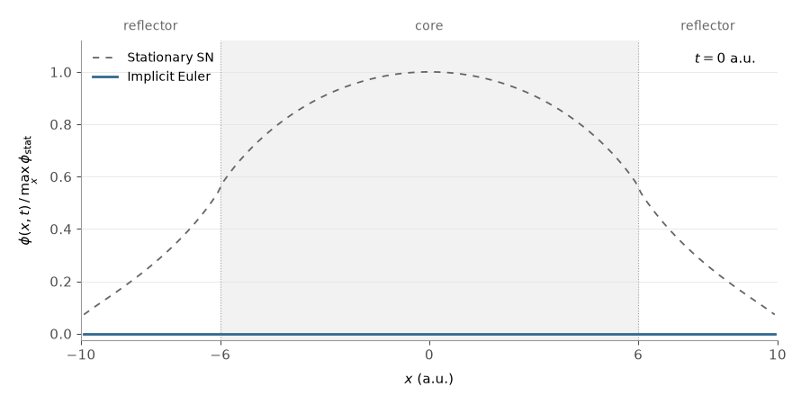

# Neutron Transport & Diffusion

A scientific Python project modeling how neutrons move, scatter, and trigger
fission in a simplified nuclear reactor. It computes neutron flux and criticality:
whether neutron production can sustain a chain reaction.



Scalar flux: S8 transport, implicit Euler, 120 cells. Zero initial flux and constant
source; the dashed curve is the stationary solution. Normalization is fixed.
[Explore the equations and runnable examples](notebooks/explore.ipynb)
· [Static preview](assets/transport_euler.png)

The project connects mathematical modeling, numerical simulation, and performance
optimization in a one-dimensional setting with a single neutron speed and isotropic
scattering.

- **Numerical methods:** stationary and time-dependent transport using discrete
  ordinates (SN), finite-volume diffusion, implicit Euler time stepping, and power
  iteration for diffusion criticality.
- **Performance:** Numba-compiled transport sweeps and source iterations, reusable
  work arrays, and sparse linear algebra with SciPy.
- **Validation:** tests for neutron balance, fission contributions, agreement
  between solver implementations, and time-stepping behavior.
- **Data generation:** reproducible Gaussian sampling of material properties to
  support simulation datasets and machine-learning experiments.


| Where to look | What it contains |
| --- | --- |
| [transport/](transport/) | Materials, meshes, angular quadrature, and numerical solvers |
| [models/data/](models/data/) | Material sampling and conversion to solver inputs |
| [tests/](tests/) | Numerical regression tests |
| [bibliography/](bibliography/) | Mathematical derivations and numerical analysis, in French |
| [Optimization notes](docs/optimisation_transport_sn.md) | Profiling, implementation tradeoffs, and recorded benchmarks |

To run the solver tests from the repository root in a Python 3.12+ virtual
environment:

```bash
python -m pip install numpy scipy numba
python -m unittest discover -s tests -v
```

Regenerate the animation and its static preview:

```bash
uv run --group notebooks python examples/animate_transport.py
```
